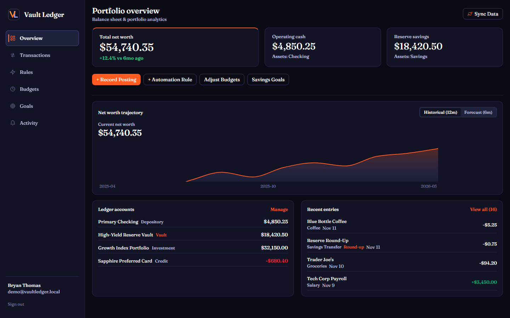
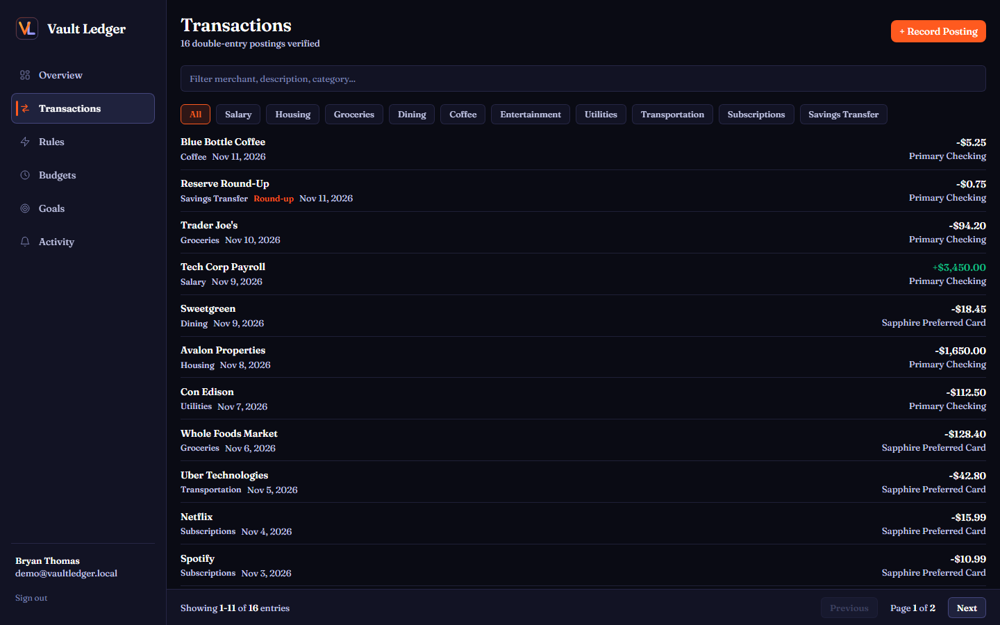
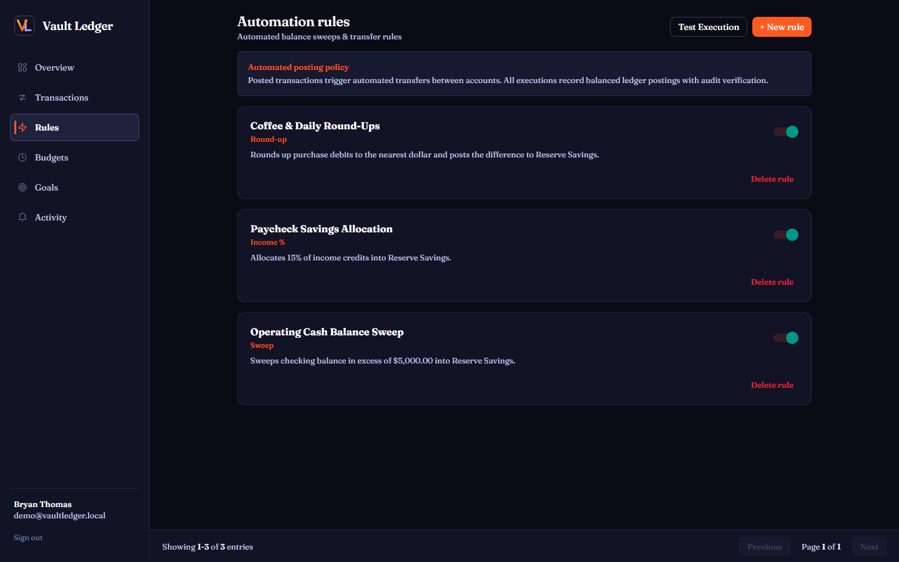
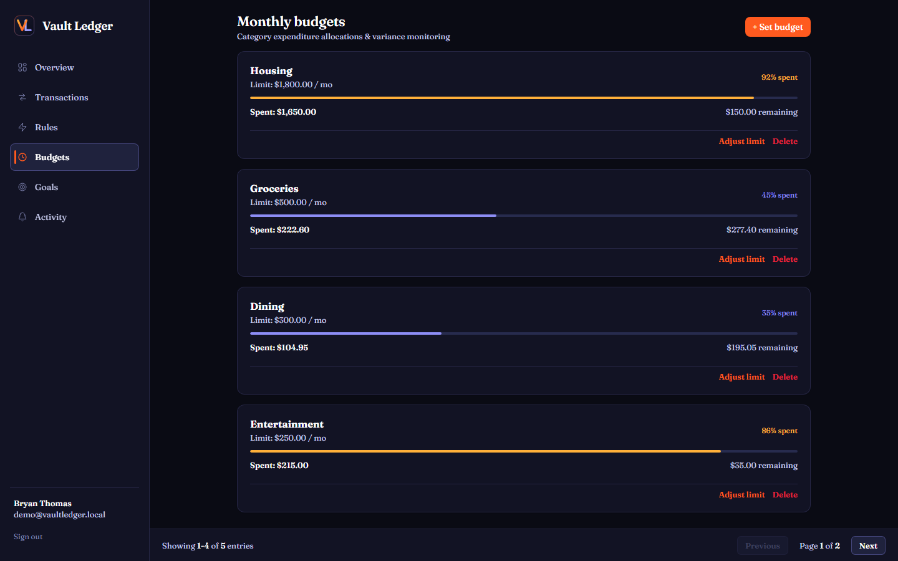
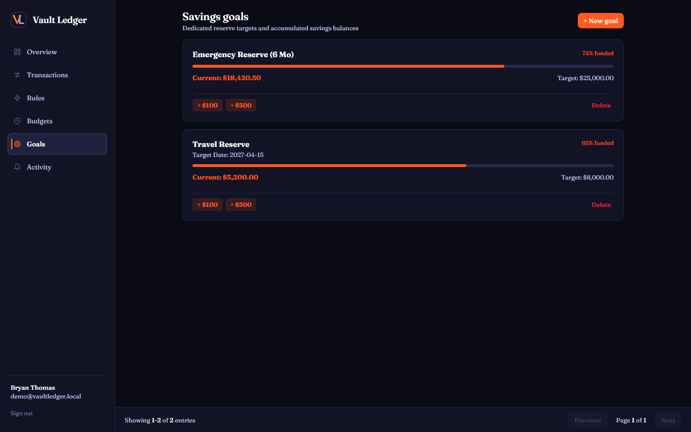
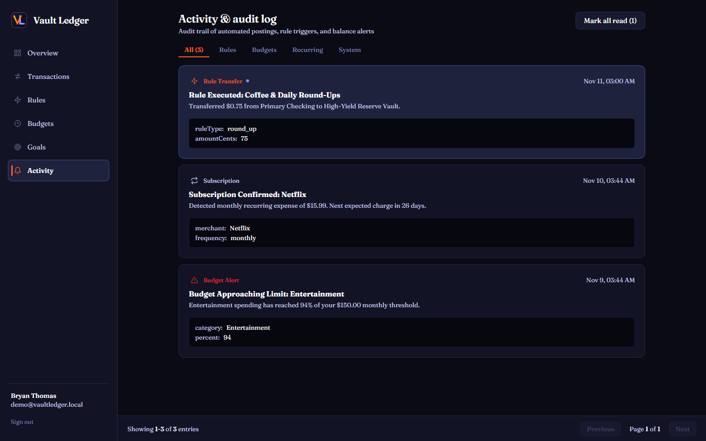

# Vault Ledger

Personal finance platform built around a double-entry accounting ledger, automated savings rules, monthly category budgets, and 6-month cash flow projections.


---

## Interface Gallery

### Portfolio Overview & Net Worth Trajectory


### Transactions & Category Filtering


### Automated Savings Rules


### Monthly Category Budgets


### Savings Goals


### Activity & Audit Log


---

## Overview

Traditional finance trackers store account balances as floating-point numbers and overwrite a single balance column when transactions occur. That approach introduces rounding drift and loses the audit trail of how a balance changed over time.

**Vault Ledger** records every financial event as an immutable double-entry journal entry composed of balanced debit and credit postings stored in integer cents (`bigint` in PostgreSQL, `number` in TypeScript). Account balances and net worth are derived directly from posting history, guaranteeing that every transfer between checking, savings, investment, and credit card accounts remains balanced.

---

## Core Capabilities

### 1. Double-Entry Accounting Core
- **Integer Cents Storage**: All monetary values are stored and calculated in signed integer cents to prevent IEEE-754 floating-point errors.
- **Zero-Sum Journal Entries**: Every `journal_entry` requires two or more `postings` whose amounts sum to zero (`sum(postings.amountCents) === 0`).
- **Dynamic Balance Aggregation**: Account balances are computed from posting history rather than mutable balance columns.
- **Account Classification**: Supports `depository`, `vault`, `investment`, `credit`, `loan`, `equity`, `income`, and `expense` account types.

### 2. Event-Driven Outbox & Automation Rules
- **Transactional Outbox Pattern**: New transactions enqueue `transaction.created` events inside the same database transaction.
- **Automated Transfer Rules**:
  - **Round-Up Rule**: Rounds everyday purchases up to the nearest dollar and transfers the spare change into a savings vault.
  - **Percent-of-Income Rule**: Detects incoming paycheck deposits and moves a configured percentage into savings.
  - **Balance Sweep Rule**: Sweeps checking balances above a configured ceiling into a reserve savings vault.
- **Idempotent Execution**: A unique constraint on `(rule_id, source_entry_id)` ensures rules never fire twice for the same transaction.

### 3. Recurring Expense Detection
- Analyzes historical merchant intervals to identify weekly (6 to 8 days), biweekly (13 to 16 days), monthly (27 to 33 days), and annual (350 to 380 days) recurring charges.
- Estimates upcoming charge dates and logs notifications when recurring subscriptions are detected.

### 4. Cash Flow Forecasting
- Combines scheduled recurring cash flows with historical daily spending variance over the trailing 90 days.
- Runs 1,000 simulation paths to produce conservative (`p10`), median (`p50`), and optimistic (`p90`) 6-month net worth bands on the interactive trajectory chart.

### 5. Cross-Platform Interface
- Built with Expo Router and React Native Web for desktop browsers, iOS, and Android from a single TypeScript codebase.
- Fixed-viewport dark interface (`#0A0B14` canvas, `#121324` surfaces, `#FF5A1F` Tangerine Flame, `#8D8DF5` Iris Violet, and `#FFB03A` Warm Gold accents) with bottom pagination across data tables.
- Dual-mode animated landing backdrop supporting both zero-overhead CSS hardware composition and interactive WebGL 2 shaders.

---

## Repository Structure

```text
vault-ledger/
├── apps/
│   ├── api/                      # Fastify 5 REST API & Ledger Engine
│   │   ├── src/
│   │   │   ├── db/               # Drizzle ORM schema, migrations, connection pool
│   │   │   ├── plugins/          # JWT authentication & OpenAPI documentation
│   │   │   ├── providers/        # Synthetic 18-month seed generator & Plaid adapter
│   │   │   ├── routes/           # REST endpoints for accounts, transactions, rules, budgets, goals
│   │   │   ├── services/         # Double-entry ledger service, Argon2id auth, forecasting
│   │   │   └── workers/          # Transactional outbox worker, rules engine, recurring detector
│   │   └── Dockerfile            # Multi-stage production container build
│   └── mobile/                   # Expo Router application (Web, iOS, Android)
│       └── src/
│           ├── api/              # API client & offline-capable local sandbox fallback
│           ├── app/              # File-based routes: (auth) login/register & (tabs) views
│           ├── components/       # Reusable UI components, SVG chart, pagination, navigation
│           ├── store/            # Zustand authentication & session state stores
│           └── theme/            # Design tokens, color palette, and typography scale
├── packages/
│   └── shared/                   # Shared TypeScript interfaces, cent math utilities, Zod schemas
├── e2e/                          # Playwright end-to-end browser verification suite
├── scripts/
│   └── serve-dist.ts             # Zero-dependency static preview & local API server
├── screenshots/                  # Application interface screenshots
├── docker-compose.yml            # Local PostgreSQL 16 configuration
└── .github/workflows/ci.yml      # Continuous Integration pipeline
```

---

## Getting Started

### Prerequisites
- **Node.js**: `v22.0.0` or newer
- **npm**: `v10.0.0` or newer
- **Docker & Docker Compose** (optional, for running the full PostgreSQL backend)

### 1. Install Dependencies

```bash
git clone https://github.com/bryanthomaas/Vault-Ledger.git
cd Vault-Ledger
npm install
```

### 2. Run with Full PostgreSQL Backend

```bash
# Start PostgreSQL 16 container on port 5433
npm run db:up

# Apply Drizzle database migrations
npm run db:migrate

# Launch Fastify API (port 3000) and Expo Web (port 8081)
npm run dev
```

### 3. Run Standalone Web Preview (No Database Required)

You can also build the web bundle and run the standalone preview server with persistent local JSON storage on port `8199`:

```bash
npm run build:web -w @vault-ledger/mobile
npx tsx scripts/serve-dist.ts
```

Then open [http://localhost:8199](http://localhost:8199) and click **Explore demonstration ledger** to load the pre-populated 18-month sandbox account, or sign in with:
- **Email**: `demo@vaultledger.local`
- **Password**: `DemoPass123!`

---

## REST API Endpoints

When the Fastify server is running on port `3000`, interactive OpenAPI documentation is available at `http://localhost:3000/docs`.

| Method | Endpoint | Description |
| :--- | :--- | :--- |
| `POST` | `/api/auth/register` | Register a new user account with Argon2id password hashing |
| `POST` | `/api/auth/login` | Authenticate user credentials and issue JWT access/refresh tokens |
| `POST` | `/api/auth/demo` | Provision an 18-month demonstration sandbox account |
| `GET` | `/api/accounts` | List user accounts with aggregated balances |
| `GET` | `/api/transactions` | Query ledger postings with search, category filter, and pagination |
| `POST` | `/api/transactions` | Record a new balanced double-entry journal posting |
| `PATCH` | `/api/transactions/:id/category` | Update transaction category assignment |
| `GET` | `/api/rules` | List configured automation rules |
| `POST` | `/api/rules` | Create a round-up, income percentage, or balance sweep rule |
| `PATCH` | `/api/rules/:id/toggle` | Enable or disable an automation rule |
| `GET` | `/api/budgets` | Fetch monthly category budgets and current period spend |
| `POST` | `/api/budgets` | Create or update a monthly category budget limit |
| `GET` | `/api/goals` | List savings goals and progress metrics |
| `POST` | `/api/goals` | Create a new savings goal |
| `GET` | `/api/notifications` | Retrieve activity and audit notifications |
| `POST` | `/api/notifications/read-all` | Mark all activity notifications as read |
| `GET` | `/api/insights/spending` | Category spending breakdown and month-over-month comparison |
| `GET` | `/api/insights/forecast` | 6-month net worth projection with confidence intervals |
| `GET` | `/health` | Service liveness and database connectivity check |

---

## Testing & Quality Checks

```bash
# Run unit and integration tests across workspaces (Vitest)
npm test

# Run strict TypeScript typechecking across all packages
npm run typecheck

# Run ESLint static analysis
npm run lint

# Run Playwright end-to-end browser tests
npx playwright test
```

---

## License

MIT License (c) [Bryan Thomas](https://github.com/bryanthomaas)
